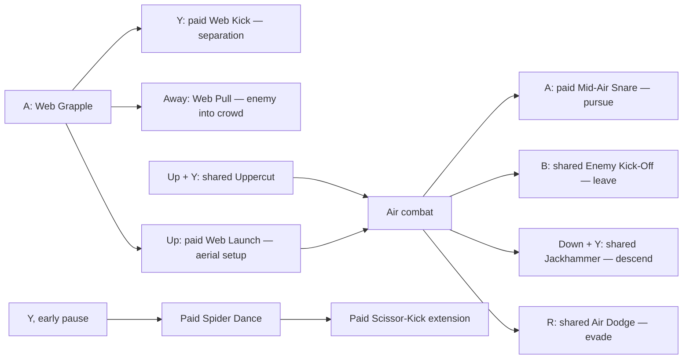
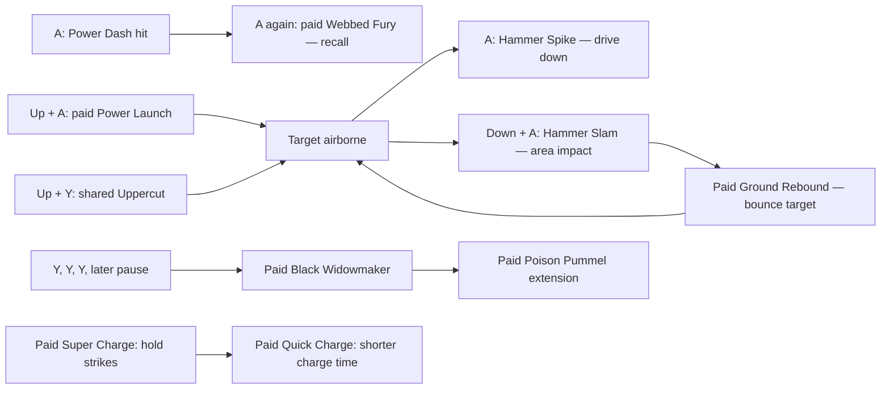

# Original CS5E gameplay reference

2026-10-04. Baseline: the **USA Nintendo DS game**, not the console/PC game.
This reference describes the original red and black forms before the TASM
replacements. The mod's white texture still uses the original black-form gameplay.
Snap Sweep and the approved TASM kit are tracked separately in
[TASM1_IMPLEMENTATION.md](TASM1_IMPLEMENTATION.md) and
[TASM1_UPGRADE_PLAN.md](TASM1_UPGRADE_PLAN.md).

The game's strongest organizing idea is that the same small set of buttons has
different contextual jobs: red **places and pursues** enemies with webs, while
black **drives, recalls and slams** them. Both forms share the tools needed to
launch, recover, evade and move around a room. This is a design interpretation of
the native instructions below, not a claim that the developers stated this intent.

## Evidence and confidence

| Label | What it establishes |
|---|---|
| **Native instruction** | A description decoded from hash-identified clean `American.strings`/`English.strings`; establishes the game's advertised input and role. It does not establish exact damage, timing or resistance. |
| **Menu observation** | A price, category, input glyph or ownership check seen in a running original-routing ROM using an isolated battery copy. Cosmetics and shortened QoL descriptions can differ from clean text. |
| **Runtime observation** | A bounded action/asset correlation from read-only player traces. It is evidence for that tested situation, not a complete action-state-machine map. |
| **Static code finding** | A hash-bounded instruction/data-table path in the original ARM9. Runtime contact tests must verify how its inputs occur during actual play. |
| **Design interpretation** | A useful explanation or composition built from those facts. A proposed sequence is not proof of an animation cancel or uninterrupted juggle. |
| **Unknown** | Requires code analysis or a controlled test; do not fill it with a familiar mechanic from another Spider-Man game. |

Clean ROM SHA256:
`61a6ed6e67fcce5cc63843fafeb0c0e6072bb750f552d5ff5d690cda02ea9203`.
Clean English/American string asset SHA256:
`19474ce9a50c25538515e585727e4ad5878bc3bb7bb11dd987b72a7c1d556088`.
String IDs below are zero-based slots exposed by
`tools/qol_suits_menu.py::StringSlots`. Tables paraphrase the instructions rather
than reproducing the extracted text archive. No copyrighted asset is included.

Private menu evidence remains in
`build/boot-tests/Spider-Man-WoS-modded-3c7ec9a5/red-skill-inventory/` and
`shared-skill-audit/`. Price observations use the original skill slots, which the
stage-one mod did not change. These images are not distributed in Git.

## Controls and contextual language

Use **DS buttons** as the canonical notation. Keyboard mappings are player-local
and can change; the configured DeSmuME mappings inspected on 2026-10-04 are included
only as a convenience.

| DS input | Function | Current keyboard | Clean glyph / evidence |
|---|---|---|---|
| D-pad | Movement, crouch, aiming and contextual directions | Arrow keys | Native direction glyph; instructions 394, 406 and skill descriptions |
| **Y** | Attack / combo strikes | **Q** | `U+E601`; menu screenshots and tutorial 391 |
| **B** | Jump; contextual swing, hang, wall jump and enemy kick-off | **Space** | `U+E600`; screenshots and 182, 230, 233, 236, 401 |
| **A** | Red web actions / black dash and hammer actions | **W** | `U+E602`; 245, 248, 254, 257, 260 |
| **X** | Pick up / throw objects | **T** | `U+E603`; 242 |
| **R** | Evade / purchased air evade and recovery | **E** | `U+E604`; 173, 176, 179, 419 |
| **L** | Switch form | **R** | `U+E605`; 131, 409 and tested form change |
| **SELECT** | Change lower-screen minimap/objective mode | Player-local | Tutorial 403 |

**Y = attack, A = form-specific power, B = jump** is the DS layout. A purchase can
add a new response to an existing button/context without adding another button.
The menu uses the shoulders to change tabs while the gameplay shoulders have the
functions above. The word **pause** in a combo means a gap between attack presses;
it does not mean opening the Pause Menu. Its exact timing window is not mapped.

## Shared foundation

The original game already combines normal attacks, movement, wall play, evasions
and object interactions. The Default/core descriptions establish the following
roles; exact story availability of each tool is not inferred from its menu group.

| Tool | Native input / context | Role | Description slot |
|---|---|---|---:|
| Suit Change | L | Changes red/black form | 131 |
| Wall Crawl | D-pad after attaching to an ordinary wall or ceiling | Room traversal and positioning | 227 |
| Web Swing | B while airborne near an ordinary surface; hold to keep swinging, release to detach | Pendulum traversal and approach | 230 |
| Web Hang | B while still on a ceiling; Up/Down changes line length | Stationary vertical positioning | 233 |
| Wall Jump | B beside a wall | Leaves the wall and redirects movement | 236 |
| Wall Run | Run into a wall while holding Up, or dash into it | Transfers a ground approach onto the wall | 239 |
| Spider Strength | X to lift; Y or X to throw | Object interaction / thrown attack | 242 |
| Ground evade | R | Avoid an enemy attack | 419 |

Seven **Both Suits** purchases extend this foundation. Costs are XP, confirmed
from the native 32-byte menu records. The complete Red, Black and shared tables
are cross-checked in ORIGINAL_GAMEPLAY.json. An earlier screenshot interpretation
assigned Enhanced Dodge 400; its native record establishes 800.

| Shared purchase | Observed cost | Native input / effect | Contribution to flow | Slots |
|---|---:|---|---|---|
| Launching Uppercut | — | Up + Y launches an enemy | Ground-to-air bridge | 162–164 |
| Enemy Kick-Off | 200 | B against a mid-air enemy kicks Spider-Man backward | Aerial separation / exit | 180–182 |
| Drill Kick | 400 | Y from a roll makes a multi-hit kick | Evasion-to-offense bridge | 165–167 |
| Jackhammer Stomp | 600 | Down + Y in the air makes a four-hit stomp | Aerial downward attack | 168–170 |
| Air Dodge | 200 | R in mid-air | Defensive option after leaving the ground | 174–176 |
| Enhanced Dodge | 800 | Hold R for successive dodges; steer Left/Right | Sustained defensive repositioning | 171–173 |
| Quick Recovery | — | R after being hit or knocked down recovers promptly | Returns control and creates a counterattack opportunity | 177–179 |

Those roles explain why a red-only launcher/pursuit replacement must not also
grant an air evade or a knockdown recovery. The player builds those capabilities
through separate shared purchases. Exact invulnerability windows, recovery
windows, cancel permissions and prerequisite masks remain unknown.

## Original red form: webs, pursuit and tempo

### Core form-specific tools

| Tool | Native input / context | Advertised role | Slots |
|---|---|---|---|
| Web Grapple | A on the ground; aim with the D-pad | Grapple an enemy or object | 246–248 |
| Web Pull | While grappling, press away from the direction Spider-Man faces | Pull the held enemy into other enemies | 249–251 |
| Web Zip | A + direction in the air | Travel to walls, floors or ceilings | 243–245 |

Grappling creates a **choice of follow-up**, rather than being a damage upgrade by
itself. The paid kick spends that setup on separation; the paid launch spends it
on an aerial opportunity; the core pull uses another enemy as part of the attack.
Web Zip also makes red's power button a traversal tool. Enemy eligibility, grapple
duration, aiming selection, collision and resistance need measured tests.

### Seven Red-tab purchases

| Original purchase | Cost | Native behavior / input | Relationship | Slots |
|---|---:|---|---|---|
| Web Kick | 100 | Y during a grapple pulls the target in and knocks it backward | Low-cost grapple follow-up | 183–185 |
| Web Launch | 200 | Up during a grapple throws the target into the air | Grapple-to-air setup | 186–188 |
| Mid-Air Snare | 600 | A in mid-air moves Spider-Man toward an enemy and performs a short attack combo | Aerial target pursuit rather than ordinary surface zip | 189–191 |
| Spider Dance | 400 | **Y → pause → Y → Y → Y** | Advanced red ground string; branch occurs early | 192–194 |
| Scissor-Kick Special | 600 | **Y → pause → Y → repeated Y** | Rapid-kick extension of Spider Dance | 195–197 |
| Amazing Speed Boost | 800 | Increases red attack speed | Passive benefit to the red attack rhythm | 198–200 |
| Ultimate Speed Boost | 1,000 | Gives red its maximum attack speed | Highest advertised red speed tier | 201–203 |

The native description expressly makes Scissor-Kick an extension of Spider Dance.
The native menu records confirm that Scissor requires Spider Dance and Ultimate
Speed requires Amazing Speed. A parent cannot be refunded while its child is
owned. The tap limit and complete combo timing windows remain unmeasured. Similarly, two speed tiers do
not disclose their numeric multipliers or stacking behavior.

### Composition map

Arrows below describe native roles that fit together. They are a design map, not
proof that every transition cancels recovery or guarantees a juggle on every enemy.

**Interpretation:** red rewards managing where combat happens, reconnecting to an
airborne target, and choosing the next branch quickly. Its paid passives reinforce
tempo. This does not prove every unmodified red attack is faster or weaker than its
black counterpart; base damage and speed comparisons are still measurements to do.

## Original black form: impact, recall and commitment

### Core form-specific tools

| Tool | Native input / context | Advertised role | Slots |
|---|---|---|---|
| Power Dash | A on the ground | Dash into enemies and throw them backward | 252–254 |
| Hammer Spike | A in the air | Drive an enemy down to the ground | 255–257 |
| Hammer Slam | Down + A in the air | Strike the ground and damage surrounding enemies | 258–260 |

Black's power button connects approach and impact. Where red first holds or
repositions a target, Power Dash makes the approach itself an attack. Black's
hammer tools give air combat a downward destination and a ground-area payoff.
The native text establishes surrounding damage for Hammer Slam; its radius and
number of hits are unknown.

### Seven Black-tab purchases

| Original purchase | Observed cost | Native behavior / input | Relationship | Slots |
|---|---:|---|---|---|
| Webbed Fury | 100 | A after a Power Dash hit recalls the target with webbing and attacks it again | Converts dash knockback into a second contact opportunity | 204–206 |
| Power Launch | 200 | Up + A launches an enemy while Spider-Man stays grounded | Grounded launch alternative | 207–209 |
| Ground Rebound | 600 | Hammer Slam makes struck enemies bounce into the air | Downward slam reconnects to aerial combat | 210–212 |
| Black Widowmaker | 400 | **Y → Y → Y → pause → Y → Y** | Advanced black ground string; branch occurs later | 213–215 |
| Poison Pummel | 600 | **Y → Y → Y → pause → repeated Y** | Barrage extension near the end of Black Widowmaker | 216–218 |
| Super Charge | 800 | Hold Y during each strike to charge it | Adds deliberate hold timing to strikes | 219–221 |
| Quick Charge | 1,000 | Charge attacks reach full power in half the time | Reduces the charging commitment of the previous system | 222–224 |

Black prices are confirmed from the native menu records at 0x02120420, with
seven rows of 32 bytes. Their descriptions are verified against clean slots. Precise
charge damage, what counts as full power, and whether charge affects each special
attack are unknown. The clean Quick Charge description establishes a **one-half
time** claim, but it does not establish the underlying timer units or exact frames.

### Composition map

The bounce arrow records the native effect. It does not establish an infinite
slam loop, a guaranteed relaunch against bosses, or any airtime reset.

**Interpretation:** black rewards committing to contact, reclaiming a target that
was knocked away, and turning vertical movement into a slam/bounce cycle. Holding
strikes for charge gives its late upgrades a different rhythm from red's passive
speed boosts. Poison Pummel changes the late end of the string; Scissor-Kick changes
the early red branch. This distinguishes the forms even though they share Y and A.

## How the two identities fit together

| Design axis | Red native tools | Black native tools | What a replacement must respect |
|---|---|---|---|
| Approach | Aim a grapple / zip toward a surface or target | Dash makes contact an attack | Keep each approach's exposure, range and target rules measurable |
| After separation | Pull a held enemy or pursue it in the air | Recall a dashed enemy with Webbed Fury | Do not turn every low-cost follow-up into free launch + pursuit + damage |
| Vertical combat | Grapple launch and paid aerial pursuit | Grounded power launch, downward hammer, paid bounce | Shared Uppercut / Air Dodge / Kick-Off remain meaningful |
| Ground branch | Pause after the first attack | Pause after the third attack | Preserve recognizable input rhythm and purchase-dependent branches |
| Extended string | Scissor-Kick rapid kicks | Poison Pummel barrage near the end | Extension belongs to a purchased parent string; cap its native budget |
| Expensive tempo | Increased / maximum attack speed | Charged strikes / shorter charge commitment | Compare against valuable original passives, not just ordinary attacks |
| Traversal gates | Heavy-object grapple and surface zip | Break ichor walls/floors using dash/slam acquisitions | Cosmetic or combat changes must not block world progression |

L allows changing form; clean instructions do not specify whether switching cancels
attacks, costs a resource, preserves charge, shares an airborne target, or transfers
the combo meter. Those are test questions, not established combination mechanics.

## Purchase, world progression and rewards

### XP and save-point economy

Native tutorials 397/410/420 establish that XP purchases powers at save points;
the tutorial specifically asks the player to buy Launching Uppercut. Tutorial 421
and menu 106 expose a separate **Test Upgrades** option for practice. The menu also
contains purchase/return/clear-upgrade controls (105, 124–128); refund amounts and
temporary-test ownership behavior must be verified rather than assumed.

The Red/Black/Both Suits/Misc/Collectibles/Default categories (116–121) separate
form specialization from shared and world functions. This reference records native
slot identities and advertised dependencies. Exact XP storage, flag addresses,
story conditions, mandatory prerequisites, refund rules and availability tables
are not yet a decoded binary schema.

### Acquisitions that protect exploration

| Acquisition | Confirmed newly enabled world function | Evidence |
|---|---|---|
| Ichor Crawl | Climb ichor-covered walls | 134, 373 |
| Ichor Web | Connect swing/zip webs to ichor-covered surfaces | 137, 376 |
| Tarantula Strength | Lift heavy objects that obstruct paths | 140, 378 |
| Reinforced Web | Grapple heavy objects that obstruct paths as red | 143, 377 |
| Bulldozer Dash | Break destructible ichor walls with black dash | 146, 374 |
| Sledgehammer Slam | Break destructible ichor floors with black hammer slam | 149, 375 |

Tutorials 398–400 explicitly present ichor obstacles as unavailable **yet**. These
acquisitions are part of world access, not spare combat slots. Their order, trigger
IDs and required story states remain unmapped. Health/Damage/Defense/Life upgrades
have advertised statistical roles (152, 155, 158, 161); the numerical increments
remain unknown. Defeat consumes a Life Point before game over (402). No save layout
or relationship between every orb counter is inferred from those terms alone.

### Lower-right Combo Meter

**Established by the original tutorial:** combining attacks raises the Combo Meter,
enemies yield additional XP, and a full meter earns a large XP bonus (clean slot
**393**). Its advertised reward feeds the same XP economy used to buy combat
upgrades. The instructions do not advertise a damage multiplier or a skill-energy
cost for this meter.

**Remaining measurements:** the complete per-move credit catalog, exact XP
multipliers, switching forms during a chain, and blocked/immune/interrupted contacts.
Snap Sweep contacts and a missed-grapple control have been traced; native category,
repetition, tier and decay rules are mapped below. Different animation assets can
share a logical action while exposing different contact timing. A visible attack
animation or a GAB record alone does not prove that damage and meter credit occurred.

Controlled native-arena comparisons confirm Snap Sweep receives the original
opener's meter category. Its two contacts add approximately 12 points each,
while the HUD stays hidden at 30 or below until first activated. The follow-up
takes the gauge above 30 and reveals it. No meter-rate patch is needed; native
repetition and decay rules remain intact. See COMBO_ENGINE.md.

**Design interpretation:** the reward connects expressive combat to build
progression: using combinations earns more XP, which buys additional branches,
defensive links and tempo upgrades. That is a useful reason to preserve meter
participation when replacing moves. The word "combine" by itself does not prove
the system requires variety rather than a continuing hit chain.

### Static meter rules found during the engine investigation

These are bounded original-ARM9 code findings. Contact credit and initial HUD
visibility are also verified in the native arena; exact XP ratios are unverified.
Addresses are DS runtime addresses; ARM9 SHA256 is
`e541bfcd02441db86b43b8649aaa13570be301d302ddfb198804b78528d215dc`.
Research uses read-only disassembly and RAM probes, never a real-save edit.

| Finding | Original address / scope | Interpretation limit |
|---|---|---|
| `HUDComboMeter` reads the combo model through the pointer at `0x02145C44` | HUD vtable `0x0213C848`; model +0 tier, +4 Q12 gauge | HUD identity/model layout is a static path; pointer values are live-state dependent |
| Logical red opener 56 maps to credit kind 0; black opener 55 maps to kind 7 | Action-kind routing `0x020CC014` | Snap Sweep retained action 56, so changing its bound animation does not by itself select a different credit kind |
| Kinds 0 and 7 have the same native table values: base 15, repetition 100, expiry 180 ticks | Credit handler `0x020837D8`; kind table `0x0211BCB0` | Tier/repetition modifiers affect actual awarded gauge; ticks are not established emulator frames |
| Meter credit includes same-kind repetition suppression and expiring kind history | Same credit handler | Favors variety; exact multi-contact coalescing and hit-confirm call ordering are still under investigation |
| Tier ranges from 0 through 5; reaching gauge 100 promotes a tier and subtracts 75 gauge, with a cap at 5 | Combo model update | Static thresholds; full-meter XP award/consumption remains a separate path to map |
| Gain is scaled by tier; the six factors are approximately 0.8, 0.65, 0.5, 0.4, 0.3, 0.2 | Data table `0x0211B894` | Q12 rounding matters; these are not damage multipliers or XP multipliers |
| Decay has a grace period, initially 15 ticks and 30 after a tier increase; gauge decay begins around 0.5/tick and accelerates after tier losses | Combo update path | Timing unit and exact runtime cadence need traces |
| Taking a hit removes two tiers and resets gauge to 75 when tiers remain; tier zero clears it | Damage-related meter handler `0x02083A9C` | Verify actual call conditions for blocked, immune or multi-hit attacks |

Kind-history suppression remains distinct from the HUD threshold. A repeated
category or a whiff may earn less/no gauge; the successful Snap Sweep opener
in the controlled test earned credit normally while its HUD was hidden.

## Current engine footholds

- One `spd.xbd` binds both forms' action resources. No separate `spdB.xbd` exists
  in the supplied manifest. A common resource container does not imply identical
  controllers or rule out a future third form.
- Read-only stage-one traces identify the original red opener as logical action
  candidate **56**, selecting `spd_GroundAttack11.gmb` (archive **3370**). In the
  original-routing red chain, successors select GMB **3373/3376/3379**, the
  GroundAttack12/13/14 resources; no damage or purchase semantics follow from names.
- The alternate/black opener was observed as action candidate **55**, selecting
  `spd_GroundAttack1.gmb` (archive **3367**). Its complete branch tree is not mapped.
- Snap Sweep retains red action 56 but selects GroundAttack15's synchronized
  SCA/GMB/GAB triplet. That resource is also bound to an existing paid route. A
  payload edit can therefore affect both paths; purchase gating belongs to the
  logical route, not the filename alone.
- GAB files have verified six-byte records. Event 8 is an action marker, and event 7 resets contact tracking. Other event
  parameters remain bounded unknowns. SCA joint tracks and GMB channel boundaries
  are now decoded; their engine evidence is in ANIMATION_RESEARCH.md and
  COMBO_ENGINE.md. Do not label an arbitrary
  record as damage, contact or meter gain.

These bounded facts and private replay paths are detailed in
[TASM1_IMPLEMENTATION.md](TASM1_IMPLEMENTATION.md). Binary-format evidence belongs
in [FORMAT_NOTES.md](FORMAT_NOTES.md); this gameplay reference is the native design
baseline against which future replacements are judged.

## Measurement contract for future TASM moves

For each replacement, compare the native and candidate action using an isolated
copy of the same progress and a repeatable encounter. Record ownership, native XP
price, enemy type/resistance, position, input timing, confirmed hits, total damage,
stagger/launch/knockback, player displacement, recovery, meter gain and XP reward.
Check both **locked** and **purchased** states, then existing ownership after a
reload. Repeat in the alternate form and with relevant shared upgrades unowned.

Custom animation is welcome, but a new pose is only one part of a move. Its contact
windows, displacement, successor/cancel rules, enemy reaction, meter credit and
purchase route must agree. Protect native traversal acquisitions and shared
upgrades; preserve the original slot's power/commitment budget; document any
intentional difference. Snap Sweep remains the one approved free opener exception.

## Confirmed combo-meter encounter

The native Test Upgrades replay confirms successful Snap Sweep contacts earn
about 12 points each at tier zero. The first 12 and 24 points remain hidden;
the following attack takes the gauge above 30 and activates the HUD. This is
the original visibility rule, not a missing credit. See COMBO_ENGINE.md for
category repetition, decay, tiers, addresses and private trace paths.

Save points open with X when the overhead X prompt is present. Their native
Test Upgrades option provides a repeatable enemy without awarding XP in the
tested arena. The Pause Menu returns to the save point. Buying or testing in
a research battery copy does not change the player's live save.
